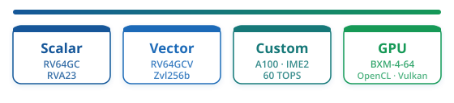

The Banana Pi **BPI-SM10** is a Pico-ITX board around the SpacemiT **K3** SoC (CoM260 / `COM3K316128…`): **8× X100** general-purpose cores (RVA23, RVV 1.0, **VLEN=256**) plus **8× A100** AI cores (**IME2**, **VLEN=1024**, up to **60 TOPS**), integrated **IMG PowerVR BXM-4-64** GPU (Vulkan 1.3 / OpenCL 3.0). Ours runs **Bianbu 4.0.6** with [EESSI](../eessi.html) on [`dev.eessi.io/riscv`](https://www.eessi.io/docs/repositories/dev.eessi.io-riscv/).

**Sponsored by [Banana Pi](https://banana-pi.org/)** — this board was provided by Banana Pi. Product page: [BPI-SM10 (K3-CoM260)](https://banana-pi.org/en/core-board-and-kit/207.html) · [docs](https://docs.banana-pi.org/en/BPI-SM10/BananaPi_BPI-SM10).

## X100 vs A100

K3 is two asymmetric RISC-V clusters. Both implement **RVV 1.0** (A100 is not scalar-only); the AI cores trade general-purpose behaviour for a wider vector unit and **IME2**. Device-tree: `spacemit,x100` (cpu@0–7) vs `spacemit,a100` (cpu@8–15).

| | **X100** (cores 0–7) | **A100** (cores 8–15) |
| --- | --- | --- |
| Role | General-purpose CPU | AI / matrix (**IME2**) |
| Clock (typ.) | up to **2.4 GHz** | up to **2.0 GHz** |
| Clusters | 0–1 (`cluster_cpus` 0–3, 4–7) | 2–3 (`cluster_cpus` 8–11, 12–15) |
| ISA (hart) | `rv64imafdcv`**`h`** + bitmanip / vector crypto | `rv64imafdcv` (no **`h`**) + same vector ext. family |
| Hypervisor | yes (`h`) | no |
| RVV | yes — **VLEN=256** (`vlenb=32`, measured) | yes — **VLEN=1024** (`vlenb=128`, measured on cpu8) |
| Custom | — | **IME2** · up to **60 TOPS** (vendor matrix path) |
| Default Linux scheduling | yes — normal SMP | **fenced** — online in sysfs, but not in a normal task’s affinity mask |

Plain RVV on A100 is often slower than on X100 without vendor IME2 code — wide VLEN is there for the matrix path, not as a drop-in “faster X60.”

### Getting onto A100 (`/proc/set_ai_thread`)

SpacemiT’s kernel keeps general threads on X100 even when A100s are idle. Stock `taskset -c 8` fails with **EINVAL** until the thread is registered as an AI thread:

```bash
echo $$ > /proc/set_ai_thread   # world-writable on Bianbu; unlocks cores 8–15 for this TID
taskset -c 8-15 …               # now affinity works; process stays on A100 for its lifetime
```

On our board `/proc/set_ai_thread` is mode `0222` (write-only). After the write, `Cpus_allowed_list` becomes **8–15** (X100 is no longer available to that task).

**VLEN pitfall:** do not start on X100 (VLEN=256), let `ld.so` cache vector decisions, then migrate to A100 (VLEN=1024) — that pattern can SIGSEGV. Prefer `set_ai_thread` **before** `exec` of the real binary (same pattern as [k3_taskset](https://github.com/zqb-all/k3_taskset) / SpacemiT’s AI runtimes).

For mixed MPI jobs (e.g. HPL), ranks on A100 each `echo $TID > /proc/set_ai_thread` then pin to cores 8–15 before `exec`. Equal rank counts are a poor fit for HPL — see [heterogeneous balancing](#heterogeneous-x100--a100) below.

## Compute paths on this board

All four paths we care about are present — and the Custom / GPU story differs from K1 (X60 **IME1** / **BXE-2-32**).



| Path | On SM10 / K3 |
| ---- | ------------ |
| **Scalar** | X100 — `rv64gc` baseline under **RVA23** |
| **Vector** | X100 RVV 1.0 · **Zvl256b** (same VLEN class as X60) |
| **Custom** | A100 cluster — **IME2** matrix path · **60 TOPS** (VLEN=1024) |
| **GPU** | **BXM-4-64** — the SKU SpaceMiT’s proprietary OpenCL/Vulkan DDK actually targets (unlike K1’s BXE) |

Per-board diagrams for the other machines: [VisionFive 2](VisionFive2.html) · [Orange Pi RV2](RV2.html) · [Banana Pi F3](F3.html). Homepage logo is the [combined view](../assets/images/compute-backends.svg).

## Status

Board is on the desk and reachable over SSH with CVMFS + EESSI (`EESSI_VERSION_OVERRIDE=2025.06-001`, software tree `riscv64/generic`). `eessi_archdetect` reports SpacemiT **X100**. Default user threads only see cores **0–7**; A100 work needs [`/proc/set_ai_thread`](#getting-onto-a100-procset_ai_thread).

## HPL (OpenBLAS RVV)

See also the [HPL app overview](../apps/hpl.html).

EESSI `foss/2025b` + `HPL/2.3`, FlexiBLAS → local **OpenBLAS 0.3.34**. Two RVV targets matter on K3:

- **`RISCV64_ZVL256B`** on X100 (VLEN=256), plus a small portability fix so stock ZVL256B wide-load + `vget` LMUL splits (which assume VLMAX@256) do not corrupt tails when run at larger VLEN.
- **`RISCV64_ZVL1024B`** on A100 (VLEN=1024) — new target: DGEMM `16×8` (+ S/C/Z/TRMM) from OpenBLAS’s `generate_kernel.py`, `-march=…_zvl1024b`. Patch: [opensolvers/benchmarks](https://github.com/opensolvers/benchmarks) `OpenBLAS/OpenBLAS-0.3.34_add-riscv64-zvl1024b.patch`.

`OMP_NUM_THREADS=1` unless noted, NB=192, residual checks **PASSED**.

### Single-cluster baselines (N=12000, 8 ranks, 2×4)

| Cluster | OpenBLAS target | GFLOP/s | Result |
| ------- | --------------- | ------: | ------ |
| **X100** only | ZVL256B | **52.0** | PASSED |
| **A100** only | ZVL256B (VLEN-safe) | **15.0** | PASSED |
| **A100** only | **ZVL1024B** | **35.9** | PASSED |

A100 ZVL1024B is ~**2.4×** the portable-ZVL256B A100 HPL rate (~**1.45×** slower than X100, vs ~3.5× before). Stock NETLIB on A100 was ~0.8 GFLOP/s @ N=4000.

A100 ZVL1024B at smaller N: **22.5** GF @ N=4000, **30.4** GF @ N=8000 (both PASSED).

### Equal 16-rank mixed (8+8), same BLAS everywhere

Ranks 0–7 on X100, 8–15 on A100 (`set_ai_thread`), 4×4 grid:

| N | BLAS on A100 | GFLOP/s | Result |
| --: | ------------ | ------: | ------ |
| 4000 | ZVL256B | 16.2 | PASSED |
| 8000 | ZVL256B | 23.7 | PASSED |
| 12000 | ZVL256B | **27.5** | PASSED |
| 12000 | **ZVL1024B** (X100 still ZVL256B) | **57.5** | PASSED |

With ZVL256B on both clusters, equal ranks stall on slow A100 work. With ZVL1024B on A100, equal **8+8** becomes the best mixed config and **beats X100-only**.

### Heterogeneous X100 + A100 (N=12000)

Per-rank FlexiBLAS: X100 → `OPENBLAS_DUAL` (ZVL256B), A100 → `OPENBLAS_ZVL1024B`. Wrap: `HPL_NX100`, `HPL_A100_THREADS`, `set_ai_thread` + `taskset`.

| Config | Ranks | Grid | A100 OMP | GFLOP/s | Result |
| ------ | ----- | ---- | -------: | ------: | ------ |
| **8 X100 + 8 A100 × 1** | **8 + 8** | **4×4** | **1** | **57.5** | **PASSED** |
| 8 + 4 × 2 | 8 + 4 | 3×4 | 2 | 56.2 | PASSED |
| 8 + 2 × 4 | 8 + 2 | 2×5 | 4 | 55.5 | PASSED |
| 8 + 1 × 8 | 8 + 1 | 3×3 | 8 | 47.6 | PASSED |
| X100 only (ref.) | 8 | 2×4 | — | **53.2** | PASSED |

(Earlier ZVL256B-everywhere hetero peaked at **51.3** GF with **8+2×4**; A100 ZVL1024B flips the optimum to equal 16 ranks.)

## IME2 (int8 GEMM)

Same `smt.vmadot` opcode as the X60, different tile. On the A100 (VLEN=1024) one instruction is **8×8×16** int8→int32. Harness: [benchmarks/ime](https://github.com/opensolvers/benchmarks/tree/main/ime) (`ime2_bench.c`), core 8 after `/proc/set_ai_thread`, userspace **1.800 GHz**. Bit-exact against the scalar reference. GOP/s is `2·M·N·K / t`, median of 15 reps. **Full** includes packing.

| M×N×K | RVV int8 | IME2 compute | **IME2 full** | full / RVV |
| ----- | -------: | -----------: | ------------: | ---------: |
| 512×512×512 | 7.58 | 102.5 | **91.6** | 12.1× |
| 768×768×512 | 7.52 | 109.1 | **103.3** | 13.7× |
| 1024×1024×512 | 7.38 | 64.2 | **61.8** | 8.4× |

The crest is 768×768×512, then 1024×1024×512 drops, the same shape as the [X60 IME1 table](RV2.html#ime-integer-matrix-extension) once the working set leaves L2. At that 768 shape the X60 full GEMM peaks at **42 GOP/s** (1.6 GHz).

The same binary with IME off, one **X100** at **2.000 GHz**: RVV int8 **15.9 GOP/s** on all three shapes. Plain RVV on the A100 is slower than on the X100. That RVV column is the untuned widening-dot baseline, not a tuned GEMM.

## llama.cpp (Q4_0)

One model, same protocol as the [RV2 Q4_0 table](../apps/llamacpp.html#measured--ime-vs-rvv-orange-pi-rv2): **Qwen2.5-0.5B-Instruct Q4_0** (403 MiB). Fork [`opensolvers/llama.cpp`](https://github.com/opensolvers/llama.cpp) branch `x60-ime-rvv` at `72d1824`, Bianbu GCC 15.2. The IME build is `GGML_CPU_RISCV64_SPACEMIT=ON`; startup logged `use_ime2: 1`, `use_ime1: 0`, `cpu_mask: ff00`. The process writes its pid to `/proc/set_ai_thread` before `exec` and is pinned to cores 8–15. Bench is `llama-bench -p 128 -n 32`. A100 userspace **1.800 GHz**, X100 **2.000 GHz**. `SPACEMIT_DISABLE_TCM=1`.

| Threads | pp128 IME2 | tg32 IME2 |
| ------: | ---------: | --------: |
| 1 | 76.43 | 21.90 |
| 2 | 149.65 | 40.24 |
| 4 | 291.12 | **58.67** |
| 8 | **525.96** | 38.78 |

X100 RVV, the VLEN=256 Q4_0 kernel, at 8 threads: pp128 **193.68**, tg32 **41.95** (1 thread: 27.69 / 11.72). Eight-thread IME2 prefill is **2.7×** that. Decode peaks at **4 threads** (58.67 t/s), above the X100’s 41.95, and drops when all 8 A100 cores are used. Prefill wants the full cluster. `llama-cli` can split the two with `-t 4 -tb 8` (`llama-bench` has no batch-thread flag).

The same model on the RV2 at 8 threads is IME **69.03 / 1.47** and RVV **100.60 / 12.18**. A short greedy completion on the IME2 build was coherent English.

The stock RVV build on the A100 does not select a Q4_0 kernel: `repack.cpp` leaves `case 1024` empty, so that run is **6.68 / 4.27** at 8 threads. The X100 row is the RVV comparison. Raw note: [benchmarks/llamacpp/results_sm10_q4_0.md](https://github.com/opensolvers/benchmarks/blob/main/llamacpp/results_sm10_q4_0.md).

## llama.cpp (Q3_K_M)

Same model, official **Q3_K_M** file (406 MiB), fork `x60-ime-rvv` at `107ead2f2`, same launch and `llama-bench -p 128 -n 32` as the Q4_0 section. The file has **no Q3_K tensors**. The large matmuls are **IQ4_NL**. FFN down is Q4_K, attention output and most attention V are Q5_0, and the `output` weight is one Q8_0 tensor. Prefill expands IQ4_NL into the Q8_0 tile and uses the IME2 int8 vmadot kernel. At 8 threads a generated token dots packed nibbles. App notes: [llama.cpp](../apps/llamacpp.html#measured--ime2-banana-pi-sm10-q3_k_m).

| Threads | pp128 IME2 | tg32 IME2 |
| ------: | ---------: | --------: |
| 1 | 69.04 | 19.14 |
| 4 | 266.35 | 45.56 |
| 8 | **499.23** | **47.95** |

Eight-thread prefill is **5.1%** below Q4_0 IME2 (525.96) and **2.7×** the build where IQ4_NL stayed on RVV (**187.64**). Decode peaks at 8 threads (47.95). At `fbcc41c` the same file was **502.10 / 46.18**, with decode peaking at 4 threads (46.61). A greedy completion on this build is coherent English. Raw note: [benchmarks/llamacpp/results_sm10_q3_k_m.md](https://github.com/opensolvers/benchmarks/blob/main/llamacpp/results_sm10_q3_k_m.md).

## llama.cpp (TinyLlama)

**TinyLlama 1.1B Chat v1.0 Q2_K** (459 MiB), same fork at `107ead2f2`, same launch and bench. The file is tagged Q2_K. Most of the matmul work is **Q3_K**. Q2_K is attention Q and K, and the `output` weight is Q6_K. Q3_K prefill uses a 4-row `vmadot.hp` kernel. Decode stays on the 1-row kernel. App notes: [llama.cpp](../apps/llamacpp.html#measured--ime2-banana-pi-sm10-tinyllama-q2_k).

| Threads | pp128 IME2 | tg32 IME2 |
| ------: | ---------: | --------: |
| 1 | 35.73 | 10.93 |
| 4 | 138.25 | 35.13 |
| 8 | **254.37** | **43.39** |

Eight-thread prefill is **1.24×** the integer Q3_K kernel on this file (205.17). Decode stays at 43 t/s. A greedy completion is coherent English. Raw note: [benchmarks/llamacpp/results_sm10_tinyllama_q2_k.md](https://github.com/opensolvers/benchmarks/blob/main/llamacpp/results_sm10_tinyllama_q2_k.md).

The BXM-4-64 GPU is still unmeasured.

## Related

- [Banana Pi BPI-SM10](https://banana-pi.org/en/core-board-and-kit/207.html) — product page (sponsor)
- [Sponsors](../sponsors.html) — how we fund extra RAM SKUs and CI time
- [opensolvers/benchmarks](https://github.com/opensolvers/benchmarks)
